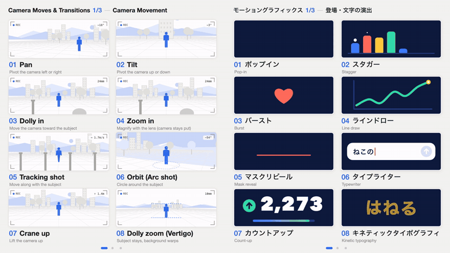

# Motion Explainer

**分享你所在领域的专业词汇，让世界更有创造力。**

[English](README.md) | [日本語](README.ja.md) | **中文** | [한국어](README.ko.md) | [Español](README.es.md)

这是一套提示词，帮你为**自己的领域制作"24 个必会名称"讲解动画**：3 段循环视频，每段 8 张小动画卡片，再加一张速查表，把你这个行业的人都该知道的名称讲清楚。
把这个仓库交给编程 AI（Claude Code、Codex、Cursor 等），告诉它你的领域，它就会陪你从头到尾做完一整套。



*用这个方法做出的两套作品。默认外观是运镜这一套的风格；如果你的领域需要别的风格，可以随意更换（动态图形这一套就是一个例子）。*

## 为什么做这个

这几天，我收到了各种各样的评论。

其中，有一位看过我帖子的朋友写下了这样一段话，让我停住了目光。

“困扰我的不是缺乏想象力，而是不知道这种动法该叫什么。”

读到它的时候，我心里强烈地想：“啊，就是这样。”

脑子里明明有画面，也有“希望它这样动”的想象。缺的不是才华，也不是想象力，而是把这份想象交给 AI 的“共同语言”。我是这么认为的。

如果各种语言、各个领域的专家，能把“想用好 AI，至少要彼此共享的这些专业术语”整理成一个库展示出来——那一定会非常非常有用。

那就先从我自己做起吧。这样想着，我把这套机制整理到 GitHub 上公开了。

“this is how you become a creative director”（这就是成为创意总监的方法）

我也收到过这样的评论，我觉得说得一点没错。把自己心中的画面好好化为语言，交给别人、交给 AI 的能力，大概正是创意指导的核心。

如果从这个仓库开始，世界各地能有越来越多的创意总监和 AI 一起发挥出色的才华，那就再开心不过了。

— 大滝昇平 Shohei Ohtaki（[@showheyohtaki](https://x.com/showheyohtaki)）

## 使用方法

1. 安装 [Node.js](https://nodejs.org/) 18 以上版本和 [ffmpeg](https://ffmpeg.org/)，然后在这个文件夹里运行：
   ```bash
   npm install
   npx playwright install chromium
   ```
2. 用你的编程 AI 打开这个文件夹，用中文贴上这段话：
   ```
   阅读 PROMPT.md 并按照它执行。
   领域：<你的领域，例如"咖啡萃取""舞台灯光""UI 组件">
   面向谁：<例如"用 AI 生图工具做商品图的人">
   ```
   提示词 PROMPT.md 是英文的，但你用哪种语言跟 AI 说话，作品就用哪种语言制作：选用你这一行在该语言里实际使用的名称，标签、速查表和发帖文案也都是这种语言。只要不是英文，每个名称下方都会附上英文名称，让任何人都知道该对 AI 输入什么。英文版或其他语言版本是可选的，AI 会在最后问你一次。

   **外观：** 什么都不说，就会做成示例的风格。加一句话就会照着改，例如“做得多彩一些”“用我们的品牌色 #1A73E8”。
3. 和它一起推进。它会停下来等你确认两次：**24 个名称的清单**做好时，以及卡片的**外观**确定时。你的专业知识在第一次确认时最重要。之后它会制作、渲染并检查视频，还会协助你完成速查表图片、独立评审和发帖文案。

## 仓库内容

```
PROMPT.md / PROMPT.ja.md   主提示词：从"我的领域"到完成一整套，共 7 个阶段（英文 / 日文）
prompts/                   主提示词会用到的辅助提示词
  cheatsheet-image.md        速查表图片（给 AI 生图工具）
  review.md                  在另一个对话里进行的独立评审
  post.md                    发帖文案，附原帖作为示例
  translate.md               把同一套内容做成另一种语言
  （每个都有日文版 .ja.md）
template/index.html        空白页面：标题、2x4 网格、标签、页码圆点、渲染约定
render.mjs                 HTML -> mp4，逐帧渲染（Playwright + ffmpeg），并生成检查用图片
check.mjs                  检测成片：格式、循环接缝、闪烁
examples/
  camera-moves/            en/ 和 ja/：HTML、3 段视频、速查表。NAMES.md：24 个名称
  motion-graphics/         ja/：HTML、3 段视频、速查表。NAMES.md：24 个名称
```

## 示例

| 作品 | 外观 | 标签语言 | 文件 |
|---|---|---|---|
| 运镜与转场 | 相机取景框里的灰色线框场景，只有主体用蓝色 | 英文、日文 | [`examples/camera-moves`](examples/camera-moves) ・ [名称](examples/camera-moves/NAMES.md) |
| 动态图形 | 藏青色舞台配四种颜色，每张卡片都像动态设计作品集里的一个镜头 | 日文（附英文名称） | [`examples/motion-graphics`](examples/motion-graphics) ・ [名称](examples/motion-graphics/NAMES.md) |

作者的母语是日语，所以示例以日文为主，只有运镜这一套另做了英文版。mp4 和 PNG 都是原帖里用过的文件。每个 `NAMES.md` 里还有制作过程中的简短记录（评审后改了什么、难以表现的名称是怎么表现的）。

用 Chromium 内核的浏览器打开任意 `index.html` 就能看到循环播放。`?page=2` 显示第 2 页，`?t=3.5` 显示第 3.5 秒的静帧。

## 渲染原理

每段视频都是一个在 `<canvas>` 上绘制的 HTML 页面。不使用实时时钟：每一帧都根据帧序号绘制。

| HTML 中 | 含义 |
|---|---|
| `window.N_FRAMES` | 一页的帧数（282 = 9.4 秒 x 30 fps） |
| `window.renderFrame(i)` | 绘制第 `i` 帧 |
| `window.prepareFrame(i)` | 可选，可以是异步 |
| `window.READY` | 字体准备好后为 `true` |
| `?page=N`、`?render=1` | 指定页码 / 关闭预览循环 |

`render.mjs` 逐帧调用 `renderFrame(i)`，读取 canvas，再交给 ffmpeg，所以即使电脑较慢也不会丢帧。

```bash
node render.mjs examples/camera-moves/en/index.html --page 1          # -> out/camera-moves-en-page1.mp4
node render.mjs examples/motion-graphics/ja/index.html --all --sheet --cards  # 3 段视频 + 检查用图片
node check.mjs out/motion-graphics-ja-page1.mp4                      # 格式、循环接缝、闪烁
```

选项：`--page`、`--all`、`--pages`、`--out`、`--out-dir`、`--fps`、`--crf`、`--sheet`（每页一张总览图）、`--sheet-fps`、`--cards`（每张卡片一张原尺寸图）、`--cards-fps`、`--cards-seconds`。详见 `node render.mjs --help`。
输出：1200x1350、30 fps、H.264（yuv420p）、无音频。

**字体。** 不从网络加载任何内容，也不附带字体文件。示例使用 macOS 自带字体（Helvetica Neue、Hiragino Sans、Avenir Next、SF Mono）。在 Windows 或 Linux 上，浏览器会换用其他字体，文字看起来会略有不同；日文需要安装日文字体（例如 Noto Sans JP），中文同理（例如 Noto Sans SC）。字体在每个 `index.html` 开头附近的常量里设置。由于编码设置不同，重新渲染的视频也可能与附带的 mp4 略有差异。

## 原帖

本系列的原帖（日文）：

- 网页滚动动画：https://x.com/showheyohtaki/status/2108065874511077598（本仓库未收录）
- 运镜与转场：https://x.com/showheyohtaki/status/2109112248832503895
- 动态图形：https://x.com/showheyohtaki/status/2109840044554891464

## 做了你那个领域的版本？

发帖时加上 **#MotionExplainer**。我会去看的。

## 许可证

[MIT](LICENSE)。这里的提示词、代码、视频和图片都可以用在你自己的作品里，包括商业用途。欢迎附上链接，但不是必须的。
